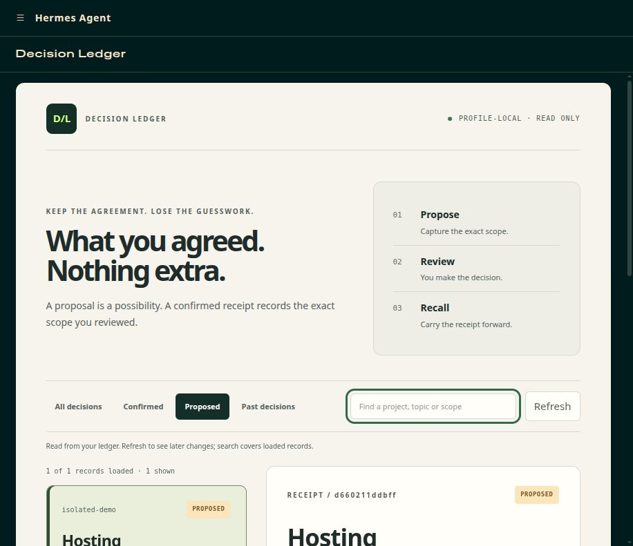

# Decision Ledger

**What you agreed. Nothing extra.**



*Actual isolated Hermes dashboard with a test proposal. No user approval was created.*

Keep exact project scope, conditions and human confirmation receipts across Hermes sessions. A proposal is a possibility. A confirmed receipt records what the operator reviewed.

## New in 0.3.2: Decision Board

A searchable, read-only board in the **Hermes web dashboard** brings your receipts into view: clear status badges, exact scope, conditions and a decision trail. The board never approves, edits or initializes a ledger. Confirmations still require the separate foreground operator console and its existing checks.

Install the plugin using the normal Hermes plugin workflow, enable it, and open `hermes dashboard`. Look for **Decision Ledger**. The board targets the web dashboard plugin API; native Hermes Desktop/HP installation has not been verified. Existing CLI/tool usage remains available.

Ask explicitly: “Use Decision Ledger to draft a proposal for personal-website / hosting: Research free hosting options only. Creating accounts, spending money, deploying, and publishing are excluded.” Review in the bundled operator console, then ask a fresh session to retrieve the exact receipt.

**Honest limits:** capture and recall depend on the assistant using the tool. This is a decision record, not an execution firewall or human identity proof. Missing receipts do not erase direct user instructions. Conditions are operator attestations, not independently verified results. Search covers loaded records; use Load more for older records. The board needs the host dashboard's authentication and displays private scope text to that authenticated session. It does not serve a public website.

Verified in an isolated official Hermes dashboard (source `396fe52b`): real plugin discovery, authenticated API, exact proposed scope, filters/search and responsive layout. Unauthenticated receipt requests return 401; viewing/filtering left database bytes unchanged. No model calls or user approvals were made. Native Desktop/HP installation remains unverified. See [validation evidence](docs/VALIDATION.md).

---

## Operator workflow and safeguards

**“I approved research. Why does the agent think I approved deployment?”**

Decision Ledger is a Hermes plugin that keeps model-proposed decisions separate from
explicit operator-confirmed receipts. It preserves exact scope, exclusions, conditions,
replacements and revocations across sessions. The model tool can propose and read;
**it cannot approve**. This is a recordkeeping workflow, not an execution gate.

## Approval guidance fix — November 9, 2026

Human approval on HP uses the separate bundled foreground `operator_console.py`.
At its prompt enter ONE line `approve ID:DIGEST`, inspect the exact uncommitted
preview, then personally type `confirm REVIEW_CODE` in that same session if desired.
Gateway `/decisions approve` and `/decisions confirm` are refused by the source
identity guard. Model tools draft/read only. Never ask an agent to launch the
operator or enter confirmation. `/decisions list` and `/decisions show` remain
readback commands. No source guard relaxation is part of this fix.

## Working flow (Hermes 0.22.4, Linux)

1. Ask Hermes to use `decision_ledger` to propose a decision for project `demo031`,
   topic `deployment`: “Research options only; do NOT implement or publish.”
   The proposed decision has an exact `ID:DIGEST` token and is **not approval**.
2. As the profile's data-owning user on a **foreground terminal**, run the bundled
   `operator_console.py` from the installed plugin directory:

   ```sh
   python3 -u /path/to/hermes-home/plugins/decision-ledger/operator_console.py
   ```

   Use the account that owns the Hermes profile's database. For a container install,
   open an interactive terminal inside that container as its data-owning user first.
   The console locates data under the same Hermes home as its plugin directory and
   refuses non-foreground/non-TTY execution or a mismatched database owner.
3. In the console, enter `list demo031 deployment` (read-only), then
   `approve ID:DIGEST`. The exact current scope and conditions are displayed in an
   **UNCOMMITTED PREVIEW**. Nothing has been approved yet.
4. Only after personally inspecting that preview, enter the displayed `confirm CODE`
   in that same foreground session within 15 minutes. Or enter `cancel CODE` or
   `quit` to leave the proposal unapproved. The console validates the live proposal,
   state revision, nonce, and preview again before committing.
5. In a later Hermes session, use the registered `decision_ledger` read tool to show
   the exact receipt. A new proposal to implement or publish is still unapproved.

**Critical integration limitation:** Hermes 0.22.4 routes live interactive CLI
`/decisions` commands through its gateway as `platform=local`, with non-null session
source. The v0.3.1 handler intentionally refuses that route for state changes: the
gateway cannot establish human-only origin from this context. The shipped standalone
**foreground local operator console** is the supported real-terminal mutation route.
Earlier direct-dispatch smoke tests did **not** prove that live gateway `/decisions
approve` works. Gateway, Desktop, messaging and model tool cannot legitimately use
the operator console as a plug-in command. Users must launch it themselves. The
model tool remains draft/read-only; `/decisions list` and `show` remain available.

### Interactive paste handling

The operator accepts **one line per `operator>` prompt**. Pasting an entire ChatGPT
answer, console output, or several command lines can queue many unrelated inputs,
including `quit`. This can result in repeated `REFUSED` messages and may leave
subsequent text running in the host shell after `quit` exits. Copy exactly **one
command line** and wait for the next prompt. For a pending confirmation, the operator
only accepts the review code generated in this same running session; an exited
session cancels its pending review. A malformed command now prints a one-line error
rather than reprinting the full menu. This reduces confusion but does **not**
claim to detect or block every multi-line terminal paste.

## Operator console commands

```text
list [PROJECT [TOPIC]]
show ID
approve ID:DIGEST [replace OLD_ID:OLD_DIGEST]
reject ID:DIGEST
revoke ID:DIGEST
satisfy ID:DIGEST EVIDENCE_NOTE_FOR_ALL_CONDITIONS
confirm REVIEW_CODE
cancel REVIEW_CODE
help
quit
```

Finalizing a receipt requires two separate terminal inputs in the same process:
`approve/reject/revoke/satisfy` produces an uncommitted preview, then `confirm` can
commit. Preview cancellation, expiration, incorrect code, changed proposal or an
intervening state transition refuses confirmation. Historical-source-attached proposals
are deliberately refused by the standalone console because it lacks a trustworthy
native SessionDB history reader to verify that context.

`satisfy` records an operator's **attestation** about all conditions, not a test.
Replacing an active receipt retires the prior scope even if the new one has
unfulfilled conditions. A missing receipt means **unknown**, not universal denial.
This does not revoke unrelated permissions given by any other system or channel.

## Installation and packaging

Hermes `>=0.22.4` required, with actual native tests on Hermes 0.22.4/Linux.
The plugin is in this directory: `plugin.yaml`, `__init__.py`, `decision_ledger/`,
and the bundled standalone `operator_console.py`. No core fork, credentials, external
network requests, additional Python packages, telemetry, or background services.
Do not modify the running gateway's Python libraries or relax the approval guard.

After placing this directory in the Hermes profile's plugin folder, use the supported
`hermes plugins enable decision-ledger`, `hermes plugins doctor decision-ledger`,
and `hermes plugins validate /path/to/decision-ledger --install-deps` commands as
appropriate for that installation. `requires_hermes >=0.22.4` is a minimum, not a
claim that every operating system/later Hermes release has been tested.

The local operator script checks the installed runtime file digests, the DB owner's
UID, and the controlling foreground terminal. It has no command-line action arguments
and does not register an agent-callable tool or gateway approval shortcut. It can
be launched only with a deliberate shell invocation; its terminal and same-UID checks
are **not cryptographic identity or human authentication**.

## Security, privacy, and retention

The plugin stores proposed/confirmed text, selected original conversation evidence,
source/message IDs, exact command text, and timestamps in profile-local SQLite at
`<HERMES_HOME>/plugin-data/decision-ledger/ledger.sqlite3`. Some receipt content can
be sensitive. Conversation excerpt verification may read native session history
outside the plugin data directory, via Hermes native APIs. No off-machine upload.
Retention is indefinite until the profile's ledger data is separately managed.

This is **not** a security sandbox, OS-enforced approval control, permission gate,
cryptographic human attestation, or tamper-proof audit log. A process or agent that
can run arbitrary Python or write this SQLite file as the same OS user can bypass
application-level console checks or forge/edit receipts. UID+TTY checks reduce
accidental/remote UI confusion but do not make the host unforgeable. The plugin
does not execute approved deployments, check conditions itself, or stop the model
from acting via unrelated tools.

Store the SQLite database and profile path securely. Do not expose the container
terminal, Podman socket, or DB to untrusted agents. Before upgrade, back up code
and take a transaction-consistent SQLite snapshot. Do not overwrite newer receipts
with an older backup. v0.3.1 adds `pending_reviews` without rewriting old receipts.

## Tests and present verification

```sh
python3 -m unittest discover -s tests -p 'test*.py' -q
hermes plugins validate /path/to/decision-ledger --install-deps
```

The corrected source passed **63 isolated tests**, including real scratch-terminal
preview, confirmation, replay refusal and malformed-input checks. Full official
Hermes CLI validation with `--install-deps` passed all 15 checks with no warnings
and a safe security scan. Actual user-observed HP evidence on the earlier installed
version covers human preview/confirmation, new-session CLI/WebUI retrieval, natural
use and refusal to expand research-only scope into deployment. This corrected
package has not been installed on that live host. Catalog CI must validate the
exact public commit. See `docs/VALIDATION.md` and `docs/SPEC.md` for limitations.

MIT licensed. No changes to Hermes internals.
